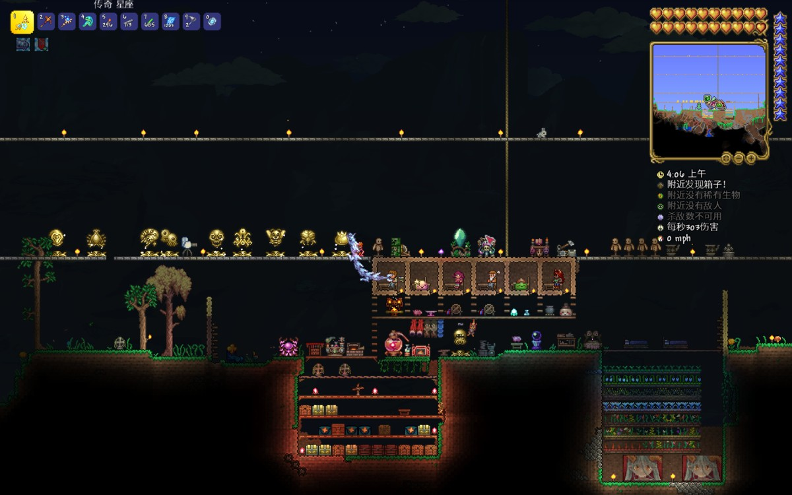

# 陈奕安 · 个人主页

一个可以直接放到 GitHub Pages 的静态个人主页。只有 HTML、CSS、JavaScript 和两张图片，没有框架、后端或构建步骤。

## 页面

- 方案 A（默认）：`index.html`
- 方案 B（左右分栏）：`b.html`

## 文件结构

```text
index.html
b.html
piano.jpg
terraria-save.jpg
README.md
```

所有文件都在同一层，没有 `assets` 文件夹，也没有子文件夹。

## 上传到 GitHub Pages

1. 在 GitHub 新建一个 **Public** 仓库。
2. 进入仓库，点 **Add file → Upload files**。
3. 把本文件夹里的 **5 个文件**一起上传到仓库根目录：
   - `index.html`
   - `b.html`
   - `piano.jpg`
   - `terraria-save.jpg`
   - `README.md`
4. 点 **Commit changes**。
5. 进入仓库 **Settings → Pages**。
6. **Source** 选择 **Deploy from a branch**。
7. **Branch** 选择 `main`，目录选择 `/ (root)`，点 **Save**。
8. 等 1–2 分钟，访问：

```text
https://你的GitHub用户名.github.io/仓库名/
```

方案 B：

```text
https://你的GitHub用户名.github.io/仓库名/b.html
```

## 为什么之前图片坏了

旧 `index.html` 里写的是：

```html


```

但 GitHub 仓库里的图片实际在根目录：

```text
terraria-save.jpg
piano.jpg
```

浏览器会去请求 `/assets/...`，找不到，所以显示破图。

现在已改成：

```html


```

并且 `b.html` 也用根目录图片。只要 5 个文件在同一层，图片就能显示。

## 注意

- 不要把 `github-pages` 文件夹本身整个上传，否则地址会多一层 `/github-pages/`。
- 不要在仓库里再建 `assets` 文件夹；当前 HTML 不读取它。
- 原稿没有提供邮箱和社交账号，页面没有编造联系方式。
